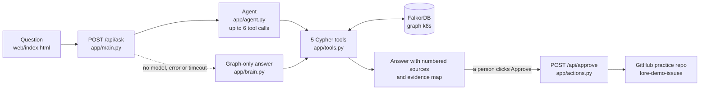

<p align="center"></p>

<p align="center"><b>Lore is a company brain on a FalkorDB graph: it shows who officially owns a part of Kubernetes, who really does the work, and why decisions were made, with a source for every claim.</b></p>

<p align="center"><a href="https://lore-company-brain.onrender.com">Live demo</a> · <a href="https://youtu.be/EXb_rKqiyMM">Demo video</a> · <a href="#run-locally">Run locally</a></p>

<p align="center"><br><i>"Who really works on sig-scheduling?": the 3 official leaders next to the people who do the work, with the evidence map.</i></p>

<p align="center"><br><i>Triage: Lore drafts a reply for a new issue, and a person picks a practice issue and approves it before anything is posted.</i></p>

## The problem and the finding

Kubernetes writes down its official owners: team leaders in `sigs.yaml` and code approvers in `OWNERS` files.
The people who actually write the designs and review the code are often someone else. So newcomers ask the wrong person.
Lore puts both lists in one graph. In **sig-scheduling, 6 of the top 8 people doing the work are not official leaders**.
`liggitt` ranks 2nd with 419 pieces of evidence, while the chair and tech lead `sanposhiho` ranks 10th.

## What Lore can do

| Tool | What it answers | Example question |
| :--- | :--- | :--- |
| `who_owns` | Official owners: team leaders, folder approvers and reviewers, KEP approvers | Who owns pkg/scheduler/framework? |
| `who_knows` | Who really does the work, ranked by KEPs and PRs they wrote, reviewed, `/lgtm`-ed or approved | Who actually knows SIG Node? |
| `why` | A decision trail: what a KEP (a written design decision) replaced, what replaced it, its releases and approvers | Why did Kubernetes choose gang scheduling? |
| `whats_stale` | Decisions still `implementable` at alpha with no new milestone for 8+ releases | Which design decisions look stuck? |
| `route_issue` | The team, `sig/*` label, related KEPs, 2 to 3 active people and a draft reply for a new issue | Where should this new issue go? "Scheduler preemption evicts the wrong pods" |
| Approve | A person approves the draft, then Lore posts it to our practice repo | Click **Approve and post** under a draft |

## Try it

Open **https://lore-company-brain.onrender.com** and ask one of these:

```text
Who actually knows SIG Node?
Who really works on sig-scheduling?
Who owns pkg/scheduler/framework?
Why did Kubernetes choose gang scheduling?
Which design decisions look stuck?
Where should this new issue go? "Scheduler preemption evicts the wrong pods"
```

- **The map:** a dark dot is an official owner (light in dark mode), a blue dot does the work but is not an official owner, and a bigger dot means more work.
- **Approve:** after a triage question, choose an issue from our practice repo [Laimos-code/lore-demo-issues](https://github.com/Laimos-code/lore-demo-issues) and click **Approve and post**.
  Lore posts the comment there and adds the `sig/*` label plus `triage/lore-suggested`. It never acts on a `kubernetes/*` repo, and the draft names people without `@`, so nobody gets pinged.
- Lore only knows public Kubernetes data. It does not store emails, names or employers.
- **API:** the same answer as JSON (`answer`, `official_owners`, `actual_knowers`, `decision_trail`, `sources`, `graph`, `steps`, and `draft` for triage):

```bash
curl -X POST https://lore-company-brain.onrender.com/api/ask \
  -H "Content-Type: application/json" \
  -d '{"question": "Who actually knows SIG Node?"}'
```

## How it works



With an AI model set (`LLM_API_KEY`), the agent picks the tools and writes a cited answer. Without one, or if the model fails, `app/brain.py` picks one tool and answers straight from the graph.

## Graph data model

FalkorDB graph `k8s`: **6,849 nodes and 57,379 edges** (counted on 2026-10-18).

| Node | Key properties | Count | Loaded by |
| :--- | :--- | ---: | :--- |
| `Person` | `login` (lowercase), `display` | 1,633 | every loader |
| `PR` | `num`, `title`, `created`, `merged` | 2,078 | `load_github.py` |
| `Issue` | `num`, `title`, `created`, `closed`, `state` | 986 | `load_github.py` |
| `KEP` | `num`, `title`, `status`, `stage`, `created`, `latest`, `latest_minor`, `path` | 679 | `load_k8s_brain.py` |
| `Folder` | `path`, e.g. `pkg/scheduler/framework` | 645 | `load_github.py` |
| `FeatureGate` | `name` | 450 | `load_k8s_brain.py` |
| `Subproject` | `name` | 240 | `load_k8s_brain.py` |
| `Release` | `version` | 59 | `load_k8s_brain.py` |
| `Team` | `key` (e.g. `sig-node`), `name`, `kind` | 52 | `load_k8s_brain.py` |
| `Component` | `name` | 27 | `load_k8s_brain.py` |

```text
OFFICIAL                                              WORK
(Person)-[:LEADS {role}]->(Team)               174    (Person)-[:AUTHORED {at}]->(PR)               2,078
(Person)-[:APPROVER_OF {source}]->(Folder)   9,285    (Person)-[:REVIEWED {at, state}]->(PR)        3,328
(Person)-[:REVIEWER_OF {source}]->(Folder)  11,748    (Person)-[:LGTM {at}]->(PR)                   2,136
(Person)-[:APPROVED]->(KEP)                  1,286    (Person)-[:APPROVED {at}]->(PR)               1,600
                                                      (Person)-[:AUTHORED]->(KEP)                   1,149
DECISIONS                                             (Person)-[:REVIEWED]->(KEP)                   1,952
(KEP)-[:OWNED_BY]->(Team)                      683    (Person)-[:AUTHORED {at}]->(Issue)              986
(KEP)-[:INVOLVES]->(Team)                      487    (Person)-[:COMMENTED {at}]->(Issue)           2,484
(KEP)-[:REPLACES]->(KEP)                         9    (Person)-[:ASSIGNED]->(Issue)                   614
(KEP)-[:SEE_ALSO]->(KEP)                       298    (PR)-[:FOR_TEAM]->(Team)                      3,131
(KEP)-[:REACHED {stage}]->(Release)          1,273    (Issue)-[:FOR_TEAM]->(Team)                   1,046
(KEP)-[:INTRODUCES]->(FeatureGate)             478    (PR)-[:TOUCHES]->(Folder)                    10,172
(FeatureGate)-[:USED_IN]->(Component)          741    (Team)-[:HAS_SUBPROJECT]->(Subproject)          241
```

- One `Person` per GitHub login: logins are lowercased, typos are fixed with `data/aliases.yaml`, and bots are dropped.
- `at` is the person's first date on that PR or issue, `source` is the OWNERS file that lists the person, and a PR author's own reviews are not counted.

## The Cypher the product depends on

**`who_knows`**: count each person's distinct PRs for a team, by kind, before a date ([app/tools.py](app/tools.py#L326), shown filled in for a team).
```cypher
MATCH (:Team {key:$key})<-[:FOR_TEAM]-(pr:PR)<-[e:AUTHORED|REVIEWED|LGTM|APPROVED]-(p:Person)
WHERE e.at < $cut
RETURN p.login, p.display, 'pr_' + toLower(type(e)), count(DISTINCT pr),
       count(CASE WHEN e.at >= $recent_from THEN 1 END)
```
**`who_owns`**: the official approvers and reviewers of a folder, with the OWNERS file that names them ([app/tools.py](app/tools.py#L272)).
```cypher
MATCH (p:Person)-[e:APPROVER_OF|REVIEWER_OF]->(:Folder {path:$p})
RETURN p.login, p.display, type(e), e.source
```
**`why`**: walk up to 6 `REPLACES` hops both ways to build the decision trail ([app/tools.py](app/tools.py#L546)).
```cypher
MATCH (k:KEP {num:$n})
OPTIONAL MATCH (a:KEP)-[:REPLACES*1..6]->(k)
WITH k, collect(DISTINCT a.num) AS newer
OPTIONAL MATCH (k)-[:REPLACES*1..6]->(b:KEP)
RETURN newer, collect(DISTINCT b.num)
```
**`whats_stale`**: KEPs stuck at `implementable` + alpha whose latest milestone is 8+ releases old; `$cutoff` is the newest release minus 8 ([app/tools.py](app/tools.py#L637)).
```cypher
MATCH (k:KEP)-[:OWNED_BY]->(t:Team)
WHERE k.status = 'implementable' AND k.stage = 'alpha'
  AND k.latest_minor >= 0 AND k.latest_minor <= $cutoff
  AND ($team IS NULL OR t.key = $team)
OPTIONAL MATCH (a:Person)-[:AUTHORED]->(k)
RETURN k.num, k.title, k.status, k.stage, k.created, k.latest, k.path, t.key, collect(a.login), k.latest_minor AS lm
ORDER BY lm, k.num
```

## Does it work? The no-peeking test

Can Lore name who will review a PR before anyone has reviewed it?

| Method (446 test PRs) | hit@1 | hit@3 | hit@5 |
| :--- | ---: | ---: | ---: |
| **Lore** (`who_knows` on the folders the PR touches, then its team) | **50%** | **77%** | **84%** |
| Busiest reviewers before the PR was opened | 18% | 43% | 57% |
| Random official SIG leads of the PR's team | 12% | 34% | 45% |
| Random OWNERS approvers of the touched folders | 6% | 16% | 27% |

Test set: merged `kubernetes/kubernetes` PRs of the 5 teams, merged on or after 2026-08-01, with a reviewer other than the author.
No peeking: for each PR, Lore only sees evidence dated before the day that PR was opened.
hit@k is the share of PRs where at least one of the top k people really reviewed, `/lgtm`-ed or approved it. Raw output: [docs/eval_reviewers.json](docs/eval_reviewers.json).

## Data and licences

- **Teams and leaders** from [kubernetes/community](https://github.com/kubernetes/community) `sigs.yaml`, **KEPs** from [kubernetes/enhancements](https://github.com/kubernetes/enhancements) `kep.yaml` files, and **code owners** from [kubernetes/kubernetes](https://github.com/kubernetes/kubernetes) `OWNERS` files. All Apache-2.0.
- **PRs, reviews and issues** from the GitHub GraphQL API (public `kubernetes/kubernetes` data, GitHub Terms of Service): PRs merged and issues opened from 2025-10-18 to 2026-10-18 with a `sig/node`, `sig/scheduling`, `sig/auth`, `sig/storage` or `sig/network` label.
- Only public GitHub logins and public activity are stored: no emails, names, employers or comment text. Lore's own code is MIT ([LICENSE](LICENSE)).

## Run locally

**Fastest: one container with the graph included** (needs Docker).
```bash
git clone https://github.com/Laimos-code/lore-company-brain.git && cd lore-company-brain
cp .env.example .env                       # every value is optional
docker build -f deploy/Dockerfile -t lore .
docker run --rm -p 10000:10000 --env-file .env lore    # open http://localhost:10000
```
**Build the graph yourself** with Docker Compose (FalkorDB on `127.0.0.1:6379`, app on http://localhost:8000).
Run these from the repo root, in this order:
```bash
docker compose up -d && pip install -r requirements.txt
# 1. Teams and KEPs (this step starts the graph from scratch)
git clone --depth 1 --filter=blob:none --sparse https://github.com/kubernetes/community.git data/community
git -C data/community sparse-checkout set --no-cone sigs.yaml
git clone --depth 1 --filter=blob:none --sparse https://github.com/kubernetes/enhancements.git data/enhancements
git -C data/enhancements sparse-checkout set --no-cone "keps/**/kep.yaml"
FALKORDB_HOST=localhost python scripts/load_k8s_brain.py data/
# 2. PRs and issues (needs GITHUB_TOKEN in .env; cached in data/raw/, so a re-run continues)
python scripts/fetch_github.py
FALKORDB_HOST=localhost python scripts/load_github.py
# 3. Official code owners (only the OWNERS files, about 6 MB)
git clone --depth 1 --filter=blob:none --sparse https://github.com/kubernetes/kubernetes data/k8s-owners
git -C data/k8s-owners sparse-checkout set --no-cone "**/OWNERS" "/OWNERS_ALIASES"
FALKORDB_HOST=localhost python scripts/load_owners.py
```
On Windows Git Bash, start the last `sparse-checkout` line with `MSYS_NO_PATHCONV=1`, or `/OWNERS_ALIASES` is turned into a Windows path.

**Settings in `.env`** (names only; see `.env.example`):
- Graph: `FALKORDB_HOST`, `FALKORDB_PORT`
- AI agent, optional (without it Lore answers from the graph): `LLM_API_KEY`, `LLM_BASE_URL`, `LLM_MODEL`
- Approve, optional: `DEMO_REPO`, `DEMO_GITHUB_TOKEN`, `DEMO_REPO_OWNER`, `APPROVE_PASSCODE`, `APPROVE_DAILY_CAP`
- Server: `TRUST_PROXY`, `ALLOWED_ORIGINS`, `USE_STUBS`; download only: `GITHUB_TOKEN`

**Tests and the evaluation** (50 tests; the graph tests skip themselves if the graph is empty):
```bash
pytest -o pythonpath=. tests/
PYTHONPATH=. FALKORDB_HOST=localhost python scripts/eval_reviewers.py 2026-08-01
```

## Deploy

- Render web service from this repo, runtime **Docker**, Dockerfile path **`deploy/Dockerfile`**, build context the repo root.
- The container starts FalkorDB privately inside itself, loads the graph from `deploy/dump.rdb`, then starts the app on `$PORT` (10000).
- Health check path: **`/api/health`** (returns `{"ok": true, "falkordb": true}`).
- Environment variables (names only): `LLM_API_KEY`, `LLM_BASE_URL`, `LLM_MODEL`, `DEMO_REPO`, `DEMO_GITHUB_TOKEN`, `DEMO_REPO_OWNER`, `APPROVE_PASSCODE`, `APPROVE_DAILY_CAP`.

## Hackathon tracks

**Track 03, Company Brain (primary)**
- Who owns what and who knows what: `who_owns` (sigs.yaml, OWNERS files) side by side with `who_knows` (KEP and PR evidence).
- Decisions traced to sources: `why` follows `REPLACES` and `SEE_ALSO` between KEPs and links each `kep.yaml`.
- Stale knowledge: `whats_stale` finds decisions stuck at alpha for 8 or more releases.
- Answers with sources: every answer has numbered links to team pages, KEPs, OWNERS files and PRs.

**Track 01, Agents That Act on Connected Data**
- Multi-hop graph queries as tools: the agent calls 5 Cypher tools, such as Person → PR → Folder and KEP → `REPLACES*1..6` → KEP.
- An action: `route_issue` drafts a triage reply, and Approve posts it to the practice repo after a person says yes.
- Explainable results: an evidence map of the nodes and edges behind each answer, and a measured no-peeking test.

## Team

- **Ashish** ([@Laimos-code](https://github.com/Laimos-code)): graph, data, tools, deployment
- **Shobhit** ([@shobhitagnihotri69](https://github.com/shobhitagnihotri69)): server and agent
- **[@Mulaydm10](https://github.com/Mulaydm10)**: actions, evaluation, testing

## AI use disclosure

AI coding assistants were used for parts of the code and the documentation.
The team reviewed and tested every change, and can explain the graph model, the Cypher queries and the architecture.
The evaluation numbers come from our own script on our own graph. More in [AI_USAGE.md](AI_USAGE.md).
